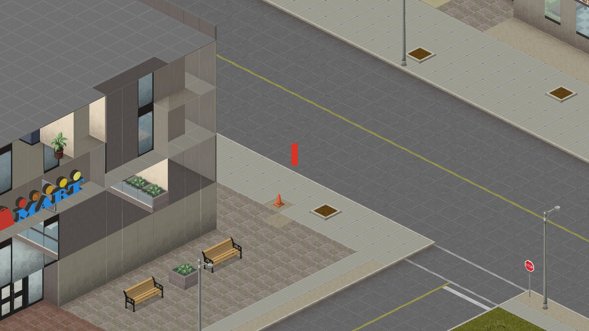
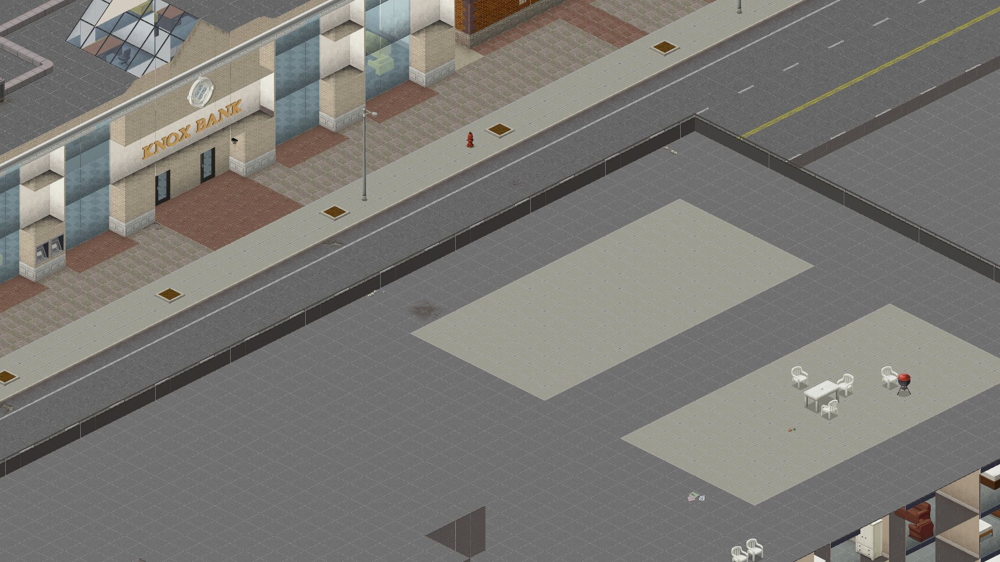

<p align="center"></p>

# pz-rust



A from-scratch Rust reimplementation of Project Zomboid (Build 42), in the spirit of
[horizon-rust/horizon](https://github.com/horizon-rust/horizon). It reads **your own** installed game files
(no game assets are included) and is checked against them with differential tests.

Crates: `pz-formats` (pack / tiles / lotheader / lotpack readers), `pz-world` (lazy cell map + collision flags),
`pz-scripts` (parser for the game's item/recipe/entity script files: 1,004 files, 5,105 items),
`pz-items` (typed item database + weight-limited inventory),
`pz-net` (binary protocol + authoritative server core; UDP transport over std::net),
`pz-server` (headless dedicated server binary),
`pz-sim` (fixed 30 Hz tick, player, zombies), `pz-viewer` (wgpu + winit isometric renderer).

```
set PZ_DIR=E:\Games\steamapps\common\ProjectZomboid
cargo run --release -p pz-viewer -- --at 12670,1660          # WASD/Shift/wheel
cargo run --release -p pz-viewer -- --shot out.png --at 12670,1660 --zoom 0.8   # headless frame
cargo run --release -p pz-server -- --bind 0.0.0.0:16261      # headless UDP server, 30 Hz
cargo run --release -p pz-viewer -- --connect 127.0.0.1:16261   # client mode (renders the server's world)
cargo test --release                                         # differential tests vs. your install
```

Status: map rendering (all floors, roofs), collision, stairs, doors (E to open/close), player movement, zombies that chase and bite, melee combat (Space). Not yet: characters/animation,
Lua, items, zombie animation/combat, audio, networking.



Site: https://lakomoor.github.io/pz-rust/

Unofficial fan project; not affiliated with The Indie Stone. Ships no game assets. Screenshots show content from the original game.
